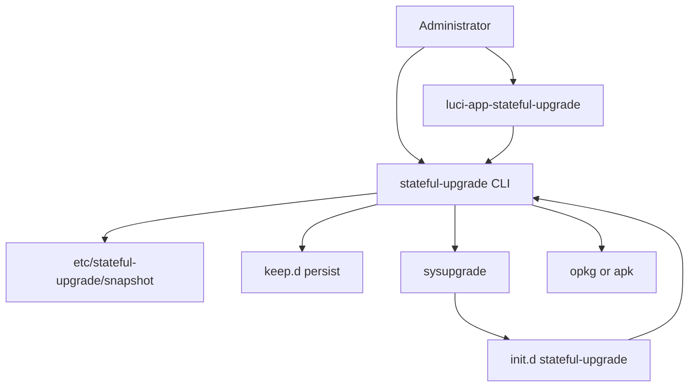
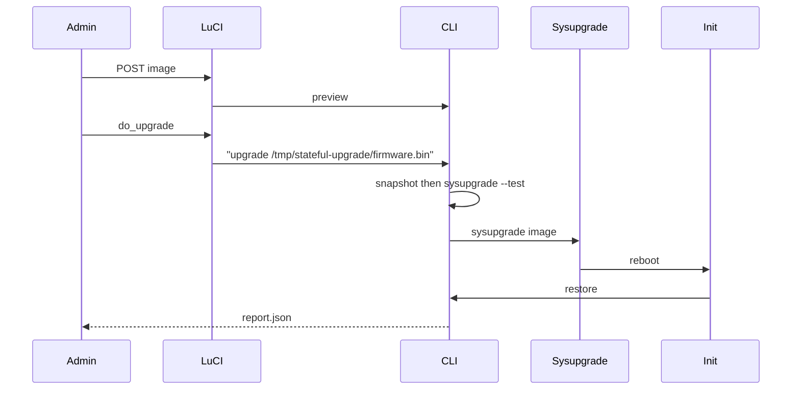

# 架构设计

## 概述

openwrt-app 提供 OpenWrt 状态保持固件升级能力。管理员通过 LuCI「系统 / 状态保持升级」或 `stateful-upgrade` CLI 上传固件；刷写前采集已安装插件、overlay 中无包归属的可执行文件、root 密码行和 SSH 配置。

sysupgrade 之后，init 脚本调用 `restore`。密码、SSH、二进制和多余插件卸载只做一次；快照中仍缺失的插件在软件源可用前每次开机重试。Web 管理、SSH、网络与防火墙相关 Essential 包不会被卸载。

新固件可能未预装本插件，因此快照目录与恢复程序路径写入 `/lib/upgrade/keep.d/stateful-upgrade`，随 sysupgrade 备份还原到 overlay。

## 技术栈

**语言与运行时**

- POSIX / BusyBox ash（恢复引擎）
- Lua 5.x（LuCI controller）
- HTML + 页面内 JavaScript（LuCI view）

**框架**

- OpenWrt package.mk
- LuCI（luci-compat，23.05 Lua 与 24.10 兼容）
- procd /etc/rc.common init

**数据存储**

- `/etc/stateful-upgrade/` 下的文本快照、progress 标记、status、report.json

**基础设施**

- OpenWrt sysupgrade + keep.d
- opkg 或 apk

**测试**

- `tests/run.sh` POSIX shell 夹具，mock opkg/sysupgrade

## 项目结构

```
openwrt-app/
├── stateful-upgrade/                 # 后端软件包
│   ├── Makefile
│   └── files/
│       ├── usr/sbin/stateful-upgrade
│       ├── usr/lib/stateful-upgrade/ # common/pkg/snapshot/restore
│       ├── etc/init.d/stateful-upgrade
│       └── lib/upgrade/keep.d/stateful-upgrade
├── luci-app-stateful-upgrade/        # LuCI 软件包
│   ├── Makefile
│   ├── luasrc/controller/stateful_upgrade.lua
│   ├── luasrc/view/stateful_upgrade/overview.htm
│   ├── po/zh_Hans/stateful_upgrade.po
│   └── root/usr/share/{rpcd/acl.d,luci/menu.d}/
└── tests/                            # 夹具测试与 mock
```

**入口点**

- `stateful-upgrade/files/usr/sbin/stateful-upgrade` CLI
- `luci-app-stateful-upgrade/luasrc/controller/stateful_upgrade.lua` LuCI
- `stateful-upgrade/files/etc/init.d/stateful-upgrade` 开机 restore

## 子系统

### CLI 与库

**目的**: 快照、升级、恢复、状态查询
**位置**: `stateful-upgrade/files/`
**关键文件**: `usr/sbin/stateful-upgrade`, `usr/lib/stateful-upgrade/*.sh`
**依赖**: opkg 或 apk、sysupgrade、tar/find
**被依赖**: LuCI、init.d

### 包管理适配

**目的**: 统一 list/install/remove/owns，保护 Essential
**位置**: `usr/lib/stateful-upgrade/pkg.sh`
**依赖**: 运行时检测 `apk`+`/etc/apk` 否则 opkg

### LuCI

**目的**: 预览、上传固件、展示 status/report
**位置**: `luci-app-stateful-upgrade/`
**关键文件**: `stateful_upgrade.lua`, `overview.htm`
**依赖**: `/usr/sbin/stateful-upgrade`

### 持久化

**目的**: 升级后仍能执行 restore
**位置**: `lib/upgrade/keep.d/stateful-upgrade`
**列入路径**: `/etc/stateful-upgrade/`、`/etc/init.d/stateful-upgrade`、`/usr/sbin/stateful-upgrade`、`/usr/lib/stateful-upgrade/`

## 图表




