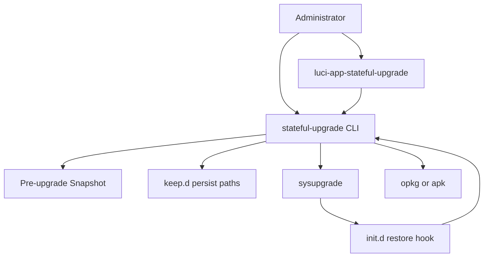
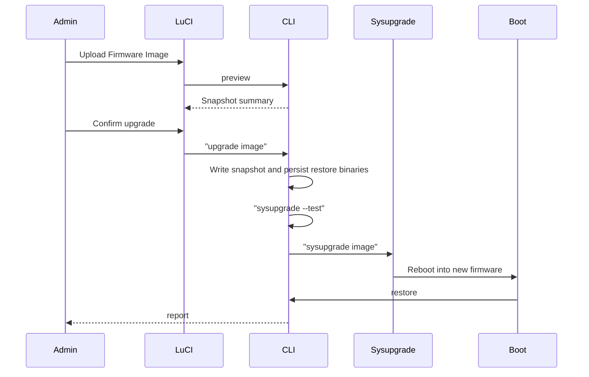

# 状态保持固件升级

Feature Name: stateful-firmware-upgrade
Updated: 2026-10-23

## Description

在 OpenWrt 上提供「上传固件 -> 保存升级前状态 -> sysupgrade -> 启动后按快照恢复」的完整能力。交付两个软件包：`stateful-upgrade`（CLI 与恢复引擎）和 `luci-app-stateful-upgrade`（LuCI 界面，挂在系统菜单）。升级后恢复 root 密码、SSH 设置、自定义二进制，并按升级前插件清单安装缺失包、卸载多余非 Essential 包。插件安装成功前每次开机重试，凭据与卸载步骤只执行一次。

## Architecture





升级后新固件可能不含本插件。因此快照数据与恢复程序都写入 sysupgrade 备份清单，随配置一起还原到 overlay。init 脚本每次开机检查未完成任务：凭据、SSH、二进制与卸载只做一次；插件安装在全部成功前保持 restoring 并重试。

## Components and Interfaces

### Package `stateful-upgrade`

安装路径：

- `/usr/sbin/stateful-upgrade`：CLI 入口
- `/usr/lib/stateful-upgrade/`：shell 库（包管理器适配、快照、恢复、essential 列表）
- `/etc/init.d/stateful-upgrade`：开机检测 pending/restoring 快照并调用 restore
- `/lib/upgrade/keep.d/stateful-upgrade`：把快照与恢复程序列入 sysupgrade 备份

CLI 子命令：

| 命令 | 行为 |
|---|---|
| `preview` | 采集但不落盘，输出 JSON 摘要 |
| `snapshot` | 写入 Pre-upgrade Snapshot，状态为 pending |
| `upgrade <image>` | snapshot 后执行 `sysupgrade --test`，通过则 `sysupgrade <image>` |
| `upgrade <image> --force` | 跳过镜像测试后刷写 |
| `restore` | 启动后按快照恢复；插件未全部装回则保持 restoring |
| `status` | 输出 idle / pending / restoring / completed / failed |
| `report` | 输出最近一次恢复报告 JSON |

LuCI 只调用 CLI，不重复实现恢复逻辑。

### Package `luci-app-stateful-upgrade`

- 依赖：`stateful-upgrade`、`luci-base`；24.10 额外依赖 `luci-compat`
- 菜单：`admin/system/stateful-upgrade`，标题「状态保持升级」
- Lua controller 负责上传固件到 `/tmp/stateful-upgrade/firmware.bin`，并 exec CLI
- View 展示 preview 摘要、上传表单、最近一次 report；status 为 restoring 时提示将在下次开机继续安装插件
- rpcd ACL 允许读取报告、上传固件、执行 CLI

### Package Manager Adapter

运行时检测：存在 `apk` 且 `/etc/apk` 为目录则使用 apk，否则使用 opkg。

| 操作 | opkg | apk |
|---|---|---|
| 已安装清单 | `opkg list-installed` | `apk info -v` |
| 安装 | `opkg install` | `apk add` |
| 卸载 | `opkg remove` | `apk del` |
| 文件归属 | `/usr/lib/opkg/info/*.list` | `apk info --who-owns` |

### Persist Strategy

`/lib/upgrade/keep.d/stateful-upgrade` 列入：

- `/etc/stateful-upgrade/`
- `/etc/init.d/stateful-upgrade`
- `/usr/sbin/stateful-upgrade`
- `/usr/lib/stateful-upgrade/`

`upgrade` 在调用 sysupgrade 前确认上述路径已存在且 keep.d 已生效。默认不使用 `sysupgrade -n`，以便备份被还原。刷写前默认运行 `sysupgrade --test`。

### Restore Order

1. 标记 status=restoring
2. 若尚未完成：恢复 Root Password State（只替换 root 行）
3. 若尚未完成：恢复 SSH Settings 并重启服务；启动失败则回退固件默认 SSH 配置，保留已恢复的 root 密码
4. 若尚未完成：恢复 Custom Binary
5. 若尚未完成：卸载不在快照中且非 Essential 的 Plugin
6. 等待网络最多 60 秒后执行 `opkg update` 或 `apk update`，安装快照中仍缺失的 Plugin
7. 若仍有快照 Plugin 未安装：写 report.json，保持 status=restoring，下次开机从步骤 6 继续
8. 若快照 Plugin 已全部安装：写 report.json，标记 snapshot consumed，status=completed

### Essential Plugin

固定集合并集包管理器 Essential 标记，并包含其直接依赖。固定集合至少包括：`base-files`、`busybox`、`procd`、`ubus`、`uci`、`netifd`、`firewall4`、`nftables`、`dnsmasq`、`odhcpd-ipv6only`、`dropbear`、`uhttpd`、`rpcd`、`luci`、`luci-base`、`luci-mod-system`、`luci-mod-network`、`luci-mod-status`、`luci-theme-bootstrap`。

### Custom Binary Discovery

扫描 overlay：`/overlay/upper/bin`、`/overlay/upper/sbin`、`/overlay/upper/usr/bin`、`/overlay/upper/usr/sbin`、`/overlay/upper/usr/local`、`/overlay/upper/opt`。可执行且无软件包归属的文件进入 `binaries.tar.gz`，保留路径、权限、uid、gid。

## Data Models

快照目录：`/etc/stateful-upgrade/snapshot/`

`meta.json`：

```json
{
  "created_at": "2026-10-23T12:00:00+00:00",
  "openwrt_release": "23.05.5",
  "pkg_mgr": "opkg",
  "status": "pending",
  "plugin_count": 12,
  "binary_count": 3
}
```

`packages.txt`：每行 `name\tversion`。

`passwd.root` / `shadow.root`：root 账户单行记录。

`ssh/`：`/etc/config/dropbear`、`/etc/dropbear/` 主机密钥、`/root/.ssh/authorized_keys`；若存在 OpenSSH 则同时保存 `/etc/ssh/` 与 `/etc/config/sshd`。

`binaries.tar.gz`：自定义二进制及 tar 元数据。

`progress.json` 记录已完成步骤：`auth`、`ssh`、`binaries`、`remove`，供重试时跳过。

`/etc/stateful-upgrade/report.json`：

```json
{
  "finished_at": "2026-10-23T12:08:00+00:00",
  "installed": ["luci-app-acme"],
  "removed": ["luci-app-example"],
  "skipped_essential": ["luci-base"],
  "failed": [{"name": "foo", "action": "install", "error": "download failed"}],
  "binaries_restored": ["/usr/bin/mytool"],
  "auth_restored": true,
  "ssh_restored": true,
  "install_pending": ["luci-app-acme"]
}
```

status 文件：`/etc/stateful-upgrade/status`，取值 `idle|pending|restoring|completed|failed`。

## Correctness Properties

- 刷写固件前快照必须完整；任一采集步骤失败则拒绝调用 sysupgrade。
- 未加 `--force` 时，`sysupgrade --test` 失败则拒绝刷写。
- Essential Plugin 不会出现在 removed 列表中。
- 恢复 root 密码只改 root 行，不覆盖新固件新增系统账户。
- 凭据、SSH、二进制、卸载在同一 Upgrade Job 中最多成功执行一次。
- 快照 Plugin 未全部安装时 status 保持 restoring，每次开机只重试安装。
- 仅当快照 Plugin 全部安装后才标记 consumed。
- keep.d 中的恢复程序足以在新固件未预装本插件时完成恢复。

## Error Handling

| 场景 | 处理 |
|---|---|
| 快照磁盘空间不足 | 中止 Upgrade Job，返回错误 |
| 固件文件为空或不可读 | 拒绝 upgrade |
| `sysupgrade --test` 失败 | 默认中止；CLI 提供 `--force` 跳过测试 |
| opkg/apk update 失败或无网络 | 凭据/SSH/二进制/卸载照常；安装失败则 status=restoring，下次开机重试 |
| 单个插件安装失败 | 记入 failed 与 install_pending，保持 restoring |
| 单个非 Essential 插件卸载失败 | 记录后继续后续卸载 |
| SSH 重启失败 | 回退固件默认 SSH 配置，保留 root 密码 |
| restore 脚本自身缺失 | 无法恢复；upgrade 阶段校验 keep 列表降低该概率 |

## Test Strategy

在仓库 `tests/` 用 POSIX shell 测试，通过注入假的 opkg/apk、overlay 目录与 passwd/shadow 夹具运行：

1. preview 统计插件与自定义二进制数量
2. snapshot 文件布局与 meta.status=pending
3. restore 安装缺失包、卸载多余非 Essential 包、跳过 Essential
4. root 行替换后其他账户保持不变
5. dropbear 配置与 authorized_keys 还原
6. 无包归属的可执行文件打 tar 再还原权限
7. 安装失败时 status 保持 restoring，第二次 restore 跳过已完成步骤并重试安装
8. 安装全部成功后快照标记 consumed，再次 restore 直接退出
9. opkg 与 apk 适配器命令拼装
10. 未加 --force 时，sysupgrade --test 失败则不刷写

LuCI 以静态检查 controller 入口与 ACL JSON 为主。完整 sysupgrade 需在真实设备或 OpenWrt 虚拟机手工验证。

## References

[^1]: (Website) - [Sysupgrade technical reference](https://openwrt.org/docs/techref/sysupgrade)
[^2]: (Website) - [Creating LuCI applications](https://openwrt.org/docs/guide-developer/luci)
[^3]: (Website) - [OpenWrt package policies](https://openwrt.org/docs/guide-developer/package-policies)
